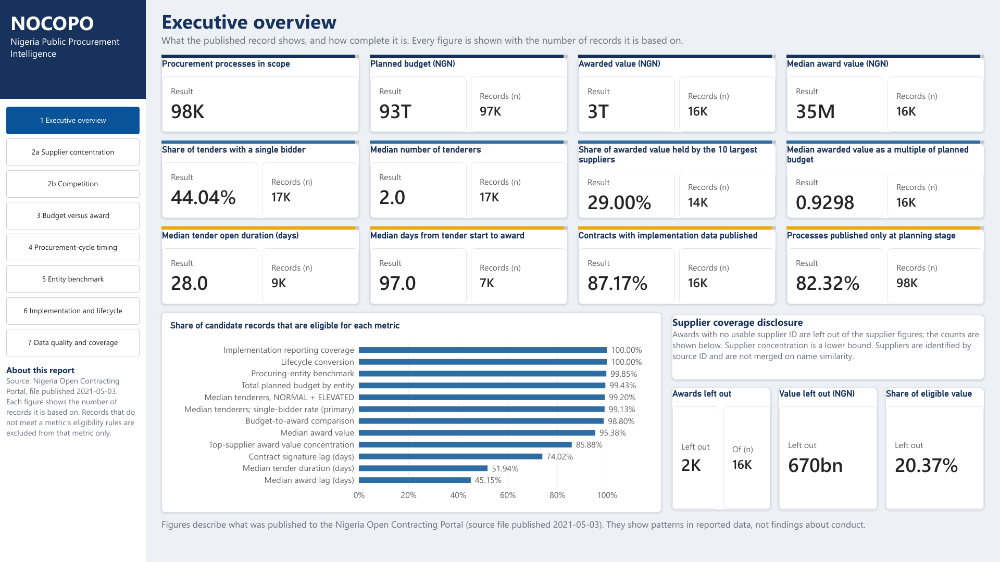
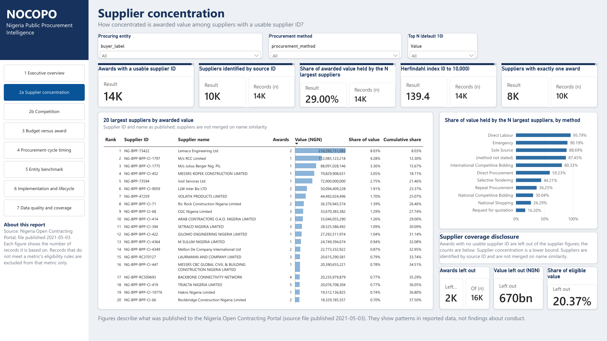
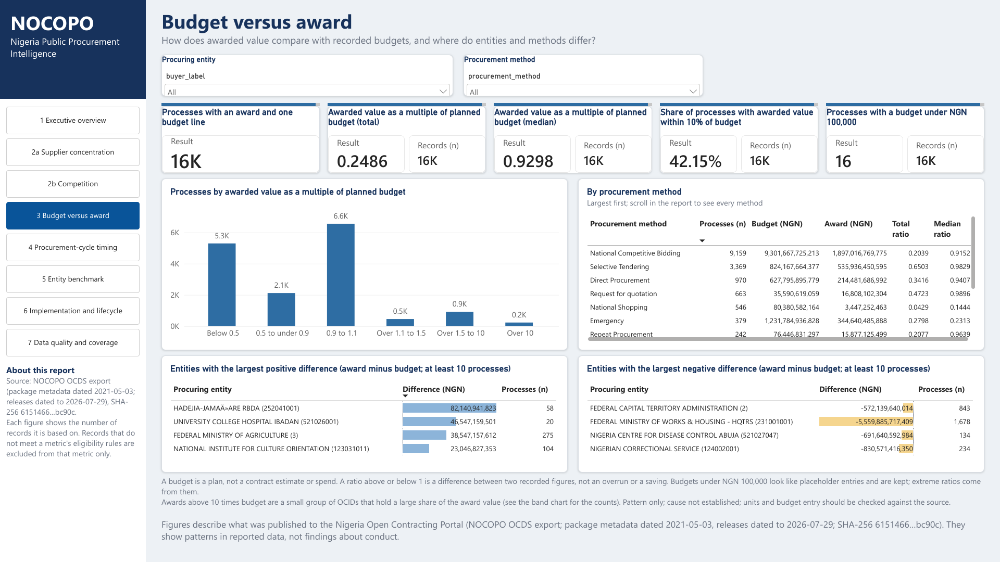
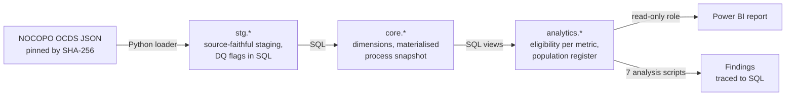

# Nigeria Public Procurement Intelligence

**An audited PostgreSQL analytics build over Nigeria's open contracting data, where every published figure traces
to a validated SQL output.**

> The Nigeria Open Contracting Portal (NOCOPO) publishes procurement records as a 210 MB nested
> OCDS JSON file. This project audits that file before modelling it, loads it into a staged PostgreSQL model
> (`stg` → `core` → `analytics`), and answers seven business questions on supplier concentration, competition,
> budget against award, cycle timing, entity benchmarking, implementation reporting and data-quality impact.
> Every metric declares its own eligible population, nothing is silently cleaned away, a Power BI report reads only
> validated views through a read-only role, and the executive findings are checked figure by figure against the SQL
> that produced them. One command rebuilds and re-validates everything from the raw file.
>

**Read first:** [executive findings](docs/phase10_findings/findings.md) ·
[dashboard screenshots](dashboard/screenshots/README.md) · [methodology](docs/methodology.md) ·
[limitations](docs/assumptions_and_limitations.md)

---

## Key findings

Descriptive patterns in published records, each with its population and main caveat. Tags such as `[S1]` resolve
to the SQL output in [`claim_trace.md`](docs/phase10_findings/claim_trace.md). Full findings, implications and
recommendations: [`findings.md`](docs/phase10_findings/findings.md).

- **Supplier value is spread widely overall but concentrated in emergency procurement.** The top ten suppliers hold
  29.0% of attributable award value (Herfindahl index 139.4); in Emergency procurement the largest supplier holds
  61.4%, and still 55.3% without the awards flagged as possible scale errors. *Population:* 13,537 awards.
  *Caveat:* 2,226 awards (₦670.4bn, 20.4% of eligible award value) have no usable supplier ID, so concentration is
  a lower bound. [S1] [S2] [S4] [S6]
- **Almost half of tenders record a single bidder.** 44.0% of 17,253 tenders record one tenderer, and 39.6% of
  10,129 tenders under National Competitive Bidding. *Caveat:* the source does not define what the tenderer count
  counts. [C1] [C3]
- **Most processes are awarded close to budget, but a small group far above it holds much of the value.** The median
  award is 0.93 of its budget across 15,574 processes, yet 227 processes (1.5%) above ten times budget hold 49.8% of
  the compared award value (39.9% without the flagged awards). *Caveat:* a budget is a plan, not spend. [B1] [B3] [B8]
- **Timing is measurable for under half of processes.** The median award lag is 97 days, but only 45.2% of candidate
  processes publish the two valid dates it needs (7,462 processes). [T1] [T2]
- **Implementation reporting is broad.** 87.2% of 16,221 contracts carry some implementation record. *Caveat:* this
  is reporting coverage, not contract performance. [I1]

The project does not make claims of misconduct or causation; patterns are prompts for review
([findings 2](docs/phase10_findings/findings.md#2-about-this-report)).

---

## Dashboard

Power BI report built on `analytics.*` only, through the read-only role `nocopo_bi`; 177 dashboard figures were
reconciled to SQL and signed off page by page ([reconciliation log](dashboard/reconciliation_log.md)). The repository
holds the `.pbit` template and screenshots; the `.pbix`, which contains imported data, is never committed.







All eight pages: [`dashboard/screenshots/`](dashboard/screenshots/README.md) · build guide:
[`dashboard/README.md`](dashboard/README.md) · usage: [`dashboard/USAGE.md`](dashboard/USAGE.md)

---

## Architecture



- **Audit before schema.** No table was designed until profiling and the data-quality decision log were complete.
- **SQL-first.** Business logic lives in PostgreSQL; Python ingests and runs checks; Power BI only presents.
- **No destructive cleaning.** Questionable records are kept and flagged, and excluded only from the metrics they
  would distort. Missing values are never imputed.
- **Eligibility per metric.** There is no single "clean dataset"; each metric reports its own population.

Detail: [`docs/methodology.md`](docs/methodology.md) and the [diagram notes](diagrams/architecture/README.md).

---

## What the data audit found

| Finding | Evidence | Treatment |
|---|---|---|
| 108,277 releases describe 98,866 processes (OCIDs); 6,280 OCIDs repeat across releases | [targeted validation](docs/phase2_profiling/targeted_validation_report.md) | Section-level snapshot; values counted once per process |
| Repeated releases are not always identical: 192 OCIDs hold unrelated budget lines | [snapshot evidence](docs/phase4_data_model/phase4_1_snapshot_validation_report.md) | Integer-ordered latest release per section; budget at the budget-line grain (C-06) |
| Text ordering of release IDs picks the wrong latest release in 1,508 OCIDs | [snapshot evidence](docs/phase4_data_model/phase4_1_snapshot_validation_report.md) | Integer `release_seq` ordering |
| Implausible tenderer counts (maximum 90,865; 65 records above 1,000) | [profiling report](docs/phase2_profiling/data_profiling_report.md) | Flagged `ANOMALOUS`, excluded from competition metrics (DQ-05) |
| Placeholder and impossible dates (`2001-01-01`, year 2922) | [profiling report](docs/phase2_profiling/data_profiling_report.md) | Classified per date column; excluded from timing metrics only (DQ-08, DQ-09) |
| Supplier identity is fragmented: 1,483 IDs carry several names, 571 names carry several IDs | [targeted validation](docs/phase2_profiling/targeted_validation_report.md) | Source IDs only; no name-similarity merging (DQ-13 to DQ-15) |
| Release dates are publication metadata; 2021-05-03 is the package date, not the date of every release | [source verification](docs/phase10_findings/source_verification.md) §D | Never used for temporal analysis (DQ-10, C-12) |
| Some awards are out of scale with their own process record | [source verification](docs/phase10_findings/source_verification.md) | Flagged, not excluded; results shown with and without them (DQ-21) |

All issues and treatments: [data-quality decision log](docs/phase3_data_quality/phase3_data_quality_decision_log.md) (DQ-01 to DQ-21).

---

## Reproduce in 5 steps

Requires Python 3.12 and PostgreSQL 15+ (developed on 17.4). The raw file is not in the repository; see
[Data access](#data-access).

1. **Clone and install** the Python dependencies:

   ```bash
   python -m venv .venv
   ```

   ```bash
   .venv/Scripts/python -m pip install -r requirements.txt
   ```

   On macOS or Linux use `.venv/bin/python`.
2. **Point at PostgreSQL** with the standard variables (`PGHOST`, `PGPORT`, `PGUSER`; defaults `localhost`, `5433`,
   `postgres`) and keep the password in `pgpass.conf` or `~/.pgpass`, never on the command line.
3. **Place the source file** at `NOCOPO dataset/all07010.json` and check its SHA-256 against
   [`data/README.md`](data/README.md). The loader refuses any other file.
4. **Build and validate** everything into a new database:

   ```bash
   .venv/Scripts/python python/run_pipeline.py --db nocopo_db --create-db
   ```

   This runs schema → staging load → core → snapshot → analytics views → read-only BI role → `ANALYZE` → validation suites
   (Phases 6–10) → the seven analysis scripts → the findings trace check, and stops at the first failure.
   It refuses to build into a database that already holds the schema.
5. **Explore:** read the regenerated [analysis results](docs/phase8_analysis/phase8_analysis_results.md) and
   [findings](docs/phase10_findings/findings.md), or open `dashboard/NOCOPO_Dashboard.pbit` in Power BI Desktop
   after setting a password for `nocopo_bi` (`\password nocopo_bi` in psql;
   [`dashboard/README.md`](dashboard/README.md)).

Step 4 rewrites the committed result logs in `docs/`; on the pinned file the only differences are run dates,
timings and the database name. Individual stages can still be run on their own (see
[`methodology.md`](docs/methodology.md) §6 and each phase document).

---

## Data access

The source is a public NOCOPO OCDS bulk export published by the Bureau of Public Procurement under the ODC Public
Domain Dedication and Licence. It is not committed (209.6 MB, over GitHub's file limit); the repository records its
origin, licence and SHA-256 instead. A fresh download from the portal will not match the checksum, so results are
reproducible only from the pinned file. Details: [`data/README.md`](data/README.md).

---

## Validation evidence

| Check | Result | Log |
|---|---|---|
| Raw file → staging reconciliation | 64 / 64 | [Phase 5](docs/phase5_staging/phase5_staging_results.md) |
| Gate B: core model (keys, integrity, values, dates, entities, layer reconciliation) | 107 / 107 | [Phase 6](docs/phase6_core_model/phase6_validation_results.md) |
| Analytical view populations against an independent recount | 27 / 27 | [Phase 7](docs/phase7_analytics/phase7_view_validation_results.md) |
| Business-question outputs and DQ-impact reconciliation | 31 / 31 | [Phase 8](docs/phase8_analysis/phase8_validation_results.md) |
| Read-only BI role and presentation dimensions (Gate C) | 16 / 16 | [Phase 9](docs/phase9_dashboard/phase9_validation_results.md) |
| DQ-21 award scale flag | 14 / 14 | [Phase 10.1](docs/phase10_findings/phase10_validation_results.md) |
| Dashboard figures reconciled to SQL | 177 / 177 | [reconciliation log](dashboard/reconciliation_log.md) |
| Gate D: every figure in the findings traced to SQL | 236 / 236 | [trace check](docs/phase10_findings/claim_trace_check_results.md) |

---

## Repository map

```
├── README.md                 This page
├── data/README.md            Source inventory, SHA-256, licence, acquisition
├── docs/                     Portfolio documents + evidence by phase (index: docs/README.md)
│   ├── business_requirements.md · methodology.md · data_dictionary.md · assumptions_and_limitations.md
│   ├── 00_project_planning/  Scope, architecture, data-quality plan, implementation plan
│   ├── phase2_profiling/ … phase9_dashboard/   Evidence and generated validation logs per phase
│   └── phase10_findings/     Executive findings, claim trace, source verification, Phase 10.1
├── python/
│   ├── run_pipeline.py       One-command rebuild and validation
│   ├── ingest/               Staging loader and raw-to-staging reconciliation
│   ├── profiling/            Phase 2 profiling scripts
│   └── validation/           Suite runner, analysis runner, trace check, source verification, link check
├── sql/
│   ├── 01_staging/           (reserved: the staging DDL lives in 02_schema)
│   ├── 02_schema/            00_draft_core_schema.sql = the executed stg + core schema (v1.x); upgrade migrations
│   ├── 03_data_quality/      Validation suites 01–12 (Gate B to Phase 10.1)
│   ├── 04_transformations/   Core dimensions and the materialised process snapshot
│   ├── 05_views/             analytics.* views (01–11)
│   └── 06_analysis/          One read-only script per business question
├── database/seed_and_setup/  Read-only Power BI role and its test
├── diagrams/                 ERD (Mermaid) and architecture notes
└── dashboard/                Power BI template (.pbit), build guide, reconciliation log, screenshots
```

---

## Tech stack

PostgreSQL 17 (CTEs, window functions, materialised views, generated columns, role-based access) · Python 3.12
(standard library, psycopg 3) · Power BI Desktop · Mermaid · Git and GitHub.

---

## Licence

Code and documentation: MIT ([`LICENSE`](LICENSE)). Source data: Bureau of Public Procurement, ODC-PDDL
([`NOTICE.md`](NOTICE.md)). This is an independent portfolio analysis, not endorsed by the BPP.
