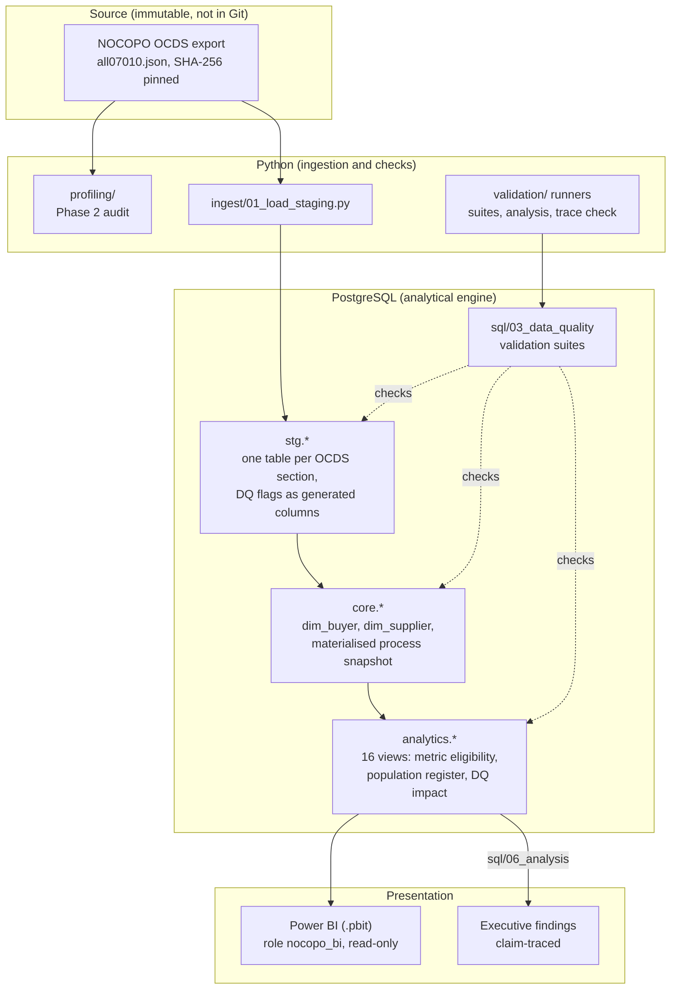
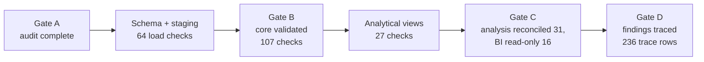

# Architecture
# Nigeria Public Procurement Intelligence

The logical architecture follows `docs/00_project_planning/NOCOPO_SQL_Project_Technology_Architecture.docx` §4:
SQL-first, with Python for ingestion and checks and Power BI for presentation only. Diagrams are Mermaid so they
render on GitHub and stay in version control with the code.

## Data flow and responsibilities

## Gates along the flow

Gate counts are the GATE checks in the committed result logs; see `docs/methodology.md` §4 for the table and links.
The entity-relationship diagram is in [`../erd/nocopo_erd.md`](../erd/nocopo_erd.md).
