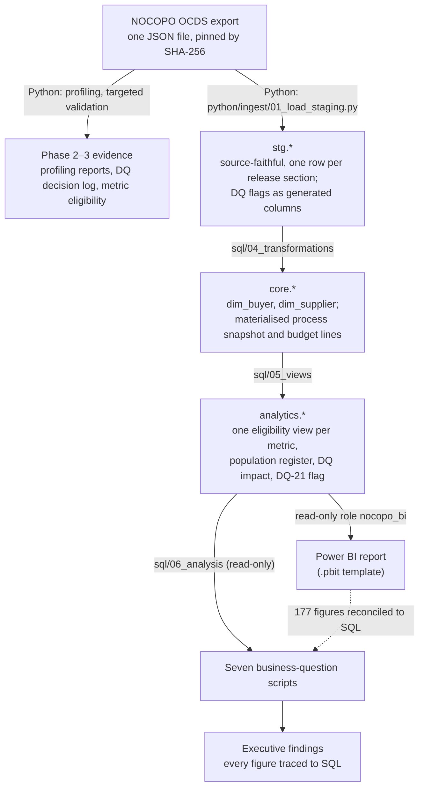

# Methodology
# Nigeria Public Procurement Intelligence

> **Status:** Final (Phase 11). A map of how the work was done; each section links to the phase evidence rather than
> repeating it. Phase index: [`README.md`](README.md).

---

## 1. Pipeline layers

| Layer | Responsibility | Where |
|---|---|---|
| Raw source | Immutable OCDS export, never edited, excluded from Git | [`../data/README.md`](../data/README.md) |
| Profiling (Python) | Structure, missingness, anomalies, before any schema | [`phase2_profiling/`](phase2_profiling/data_profiling_report.md) |
| Staging (`stg`) | Release-level tables close to the source; data-quality flags are `GENERATED` columns, so every rule lives in SQL | `sql/02_schema/00_draft_core_schema.sql`, `python/ingest/01_load_staging.py`, [Phase 5](phase5_staging/phase5_staging_reconciliation.md) |
| Core (`core`) | Entity dimensions and the process snapshot | `sql/04_transformations/`, [Phase 6](phase6_core_model/phase6_core_model.md) |
| Analytics (`analytics`) | Metric-specific eligibility views and the population register | `sql/05_views/`, [Phase 7](phase7_analytics/phase7_analytical_views.md) |
| Analysis | One read-only script per business question | `sql/06_analysis/`, [Phase 8](phase8_analysis/phase8_business_question_analysis.md) |
| Presentation | Power BI over `analytics.*` only, through a read-only role | [`../dashboard/README.md`](../dashboard/README.md), [Phase 9](phase9_dashboard/phase9_dashboard.md) |
| Findings | Evidence-proportional interpretation | [`phase10_findings/findings.md`](phase10_findings/findings.md) |

SQL is the analytical engine. Python handles ingestion, profiling, loading and running checks; Power BI only presents.
No business rule is re-implemented in Python or DAX (the dashboard's band thresholds are deliberate presentation
copies, each guarded by a reconciled band count; Phase 9 decision P-5).

---

## 2. Release and snapshot strategy

The export holds more releases than processes: an OCID (one procurement process) can appear in several releases,
and repeated releases are not always identical. Counting releases would double-count processes and values.

- **Section-level snapshot.** For each OCID, each lifecycle section (planning, tender, award, contract,
  implementation) comes from the latest release that carries it. An award and its contract always come from the same
  release. ([Phase 4 model](phase4_data_model/phase4_relational_model.md) §6;
  [evidence](phase4_data_model/phase4_1_snapshot_validation_report.md).)
- **Integer ordering.** "Latest" means the highest integer `release_seq`. Text ordering of release IDs picks the
  wrong release, and the release `date` is publication metadata, not an event date (DQ-10, correction C-12).
- **Budget-line grain.** Planned budget (M-P01) is counted once per `(OCID, budget projectID)` at its latest value,
  because some OCIDs carry several unrelated budget lines (correction C-06).
- **Materialised.** `core.vw_process_snapshot` and `core.vw_budget_lines` are materialised views; refresh them with
  `sql/04_transformations/04_refresh_snapshot.sql` after any change to `stg.*` or `core.dim_buyer`.

---

## 3. Data-quality treatment and eligibility per metric

There is no single "clean dataset". Every issue in the decision log gets a treatment from the approved categories:
in practice RETAIN, FLAG and EXCLUDE_FROM_METRIC, with some issues deferred or left unresolved. DROP was never used.
Every metric declares its own eligible population.

- **Nothing is deleted.** Questionable records stay in `stg` and `core`, flagged, and are excluded only from the
  metrics they would distort. Missing values are never imputed (a missing tenderer count is not zero).
- **No outlier trimming by rule.** Extreme values are excluded only where a documented issue applies (DQ-06, DQ-07);
  suspected entry errors below that threshold are flagged and shown as a sensitivity, not removed (DQ-21).
- **No name-based entity merging.** Suppliers and buyers are identified by source ID only (DQ-13 to DQ-15), so
  concentration is a lower bound.
- **Populations travel with results.** `analytics.vw_metric_population` gives candidate and eligible counts for
  every metric, and `analytics.vw_dq_impact` attributes each exclusion to its cause.

Evidence: [decision log](phase3_data_quality/phase3_data_quality_decision_log.md) (DQ-01 to DQ-21),
[metric eligibility](phase3_data_quality/phase3_metric_eligibility.md),
[correction logs](phase3_data_quality/phase3_2_correction_log.md) (C-01 to C-13).

---

## 4. Validation gates

The implementation plan has four hard gates; each is enforced by a reproducible suite whose checks live in SQL
(`sql/03_data_quality/`) and are run by `python/validation/04_run_validation_suite.py`.

| Gate | Condition | Suite | GATE checks | Results |
|---|---|---|---|---|
| A — Audit complete | Decision log and metric eligibility documented before any schema | Review gate (Phases 2–3) | — | [decision log](phase3_data_quality/phase3_data_quality_decision_log.md) |
| — | Raw file → staging reconciliation | stage 1 of `--phase 6` (`python/ingest/02_reconcile_staging.py`) | 64 | [Phase 5 results](phase5_staging/phase5_staging_results.md) |
| B — Core validated | Keys, nulls, referential integrity, release reconciliation, money and dates, entities, layer reconciliation | `--phase 6` (`01`–`08`) | 107 | [Phase 6 results](phase6_core_model/phase6_validation_results.md) |
| — | Each analytical view's population matches an independent recount from `stg` | `--phase 7` (`09`) | 27 | [Phase 7 results](phase7_analytics/phase7_view_validation_results.md) |
| C — Analysis reconciled | Business-question outputs spot-checked against independent recounts; `vw_dq_impact` reconciled | `--phase 8` (`10`) | 31 | [Phase 8 results](phase8_analysis/phase8_validation_results.md) |
| C (Power BI) | Power BI reads validated views only: read-only role, presentation dimensions | `--phase 9` (`11`) | 16 | [Phase 9 results](phase9_dashboard/phase9_validation_results.md) |
| — | DQ-21 flag: independent recount, scope, spot checks, populations unchanged | `--phase 10` (`12`) | 14 | [Phase 10.1 results](phase10_findings/phase10_validation_results.md) |
| D — Findings signed off | Every figure in the findings traces to a SQL output; no prohibited wording | `python/validation/07_check_findings_trace.py --live` | 236 trace rows | [trace check](phase10_findings/claim_trace_check_results.md) |

The dashboard has its own exit check: 177 figures reconciled between Power BI and SQL and signed per page
([`../dashboard/reconciliation_log.md`](../dashboard/reconciliation_log.md)).

---

## 5. How results trace to SQL

1. A figure in [`findings.md`](phase10_findings/findings.md) carries a claim tag such as `[S1]`.
2. The tag resolves to rows in [`claim_trace.md`](phase10_findings/claim_trace.md): script, result set, row, column,
   source value and eligible n.
3. The result set is logged in [`phase8_analysis_results.md`](phase8_analysis/phase8_analysis_results.md), produced
   by `python/validation/05_run_analysis_scripts.py` from `sql/06_analysis/`, which may read only `analytics.*`
   (the runner refuses any script that names `stg.` or `core.` or contains DDL or DML).
4. The analytics view is defined in `sql/05_views/` and validated by the suites above.
5. `07_check_findings_trace.py` checks steps 1–3 mechanically and fails on any untagged or mismatched figure.

Records behind the most influential anomalies were also checked in the raw file
([`source_verification.md`](phase10_findings/source_verification.md)).

---

## 6. Reproducing the build

`python/run_pipeline.py` rebuilds an empty database from the raw file and runs every suite, the analysis scripts
and the trace check, stopping at the first failure. It was proven on a fresh database on 2026-10-17 (205 s end to end): every
suite passed, every regenerated result log matched the committed one apart from run metadata (run dates, timings,
database name), and all 177 reconciliation figures matched. Steps and requirements:
[`../README.md`](../README.md#reproduce-in-5-steps). Data access: [`../data/README.md`](../data/README.md).

Two execution details keep a fresh build fast; neither changes any result. The pipeline runs `ANALYZE` on the whole
database after the views are built, so the planner has complete statistics after the bulk load. And one setting is
fixed in the suite runner: the Phase 7 suite runs with `enable_nestloop = off`. Its
independent recounts join unindexed CTEs, and on a freshly loaded database the planner's sampled statistics can
choose a nested loop that runs for many minutes; with the setting the suite takes seconds and returns identical
results. It changes how the checks execute, not what they test.

`sql/02_schema/00_draft_core_schema.sql` keeps its Phase 4 file name but is the executed schema (v1.x, with the v1.4
DQ-20 column); the `01_` and `03_` migration files exist only to upgrade databases built before Phase 8.1, and a
fresh build does not need them.

---

*Methodology version 1.0 — 2026-10-17.*
